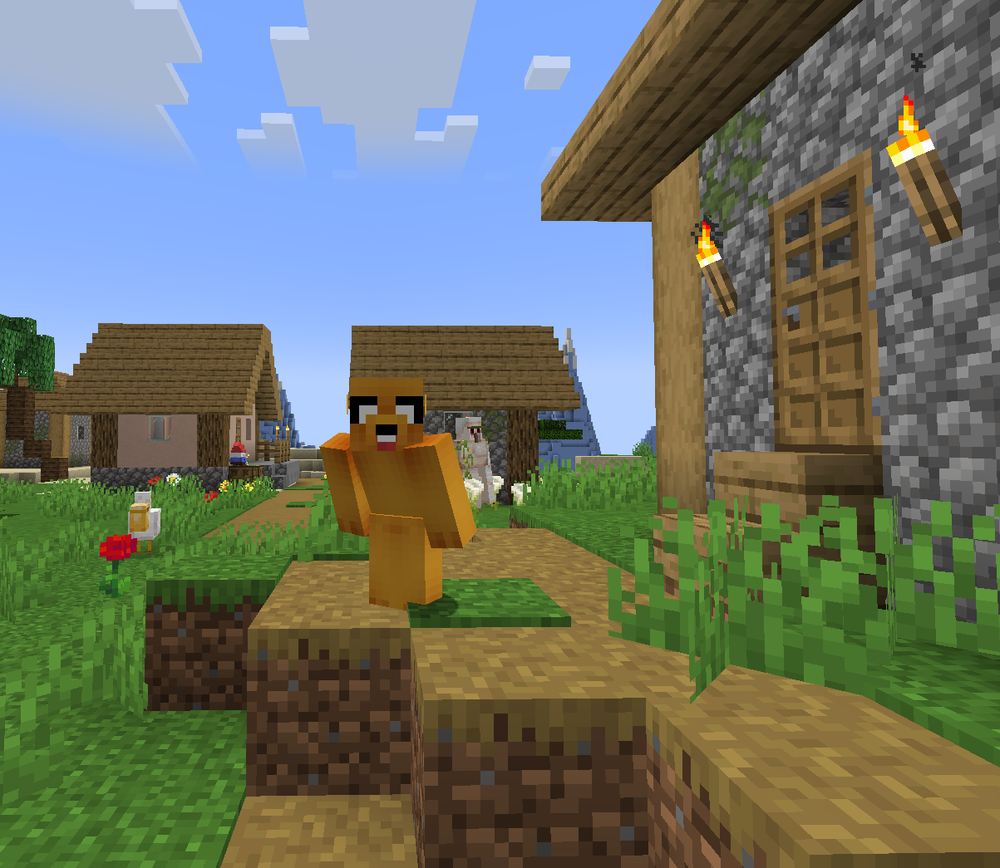

# Introduction

It's been quite an eventful last few months, I've continued to hone my craft, added some more compute to my cluster, as well as expanded the Ceph cluster. My cluster is now more resilient than it's ever been and I've been having more fun than ever building it!

A few months ago, I added Ansible & Terraform to the cluster, with Semaphore as the Ansible overlay with Gitea just for fun. It worked well, Terraform is really amazing and not that terrible to setup in the cluster.

I recently decided to try and automate using exclusively Ansible/Semaphore, just for the sake of practice. I'll explain some of the reasoning, as removing Terraform really is just a step backwards.

## Reasoning

Objectively speaking, Terraform is much better for automating system deployments in a compute cluster. It's what I want to describe as stateful (that's not really the right term but...) where once you initialize a system, Terraform knows exactly how to tear that system down, just by default.

With Ansible, you have to write it out very manually and very intentionally. It's almost like comparing how Python works vs something like C. That's just for metaphor sake, neither are really that complex.

I wanted some reps with just writing these tasks/jobs more manually, as some environments may not be able to use Terraform, or you might be running Ansible inside an airgapped system environment.

Overall, there's not much to it. I'm doing it just to familiarize myself more with writing Ansible, and also because I want to lol.

## Planning

We're looking to automate game server deployment, as my friend group tends to pretty regularly want to play games like Project Zomboid or Minecraft, and if you know anything about those games, they're just not worth playing without at least 100 mods. This can be a real pain if you're manually setting up servers, so this is a real issue I'm looking to solve.

I already have Semaphore and Gitea in my cluster, so there's not much in the way of setup.

For my lab/project, I wanted to only deploy Rocky linux machines. I created a new VM without a disk and not really much of any other settings other than a serial console and no disk. Grabbed a Rocky qcow2 image online, specifically the generic cloud image, and attached it to the template.

I setup Cloud-init on the template, added my SSH keys, and added a default user and password.


I also created an API key for the Semaphore runner to use with my Proxmox cluster, more on that later.

This is really it as far as setup goes. If I was starting from 0, I would obviously go through Semaphore and Gitea setup, but honestly those are just running in containers anyways.

## Ansible roles

Now, I could overexplain the snot out of Ansible, but I'm not really going to in this post. I'll just give a brief summary of its design and a little bit about how it works.

Ansible uses SSH to remote into machines and run jobs called playbooks, which is written in yaml. These playbooks can run in an almost inline manner, where the playbook runs everything, or the playbook can invoke other tasks almost dynamically using user created roles. 

Roles are essentially user created templates. In these roles are task files, which are very similar to playbooks, but they're meant to be more focused than playbooks.

We'll be creating 3 distinct roles in this blog post. These roles are base_server, sunlit, and zomboid.

### base_server

This is probably the most self-explanatory role, this is where we'll be running Ansible locally (using the API key we created instead of SSH into one of the hosts) to clone the template we created and add some customizations like RAM, cpu core count, VMID, IP info, etc.

Let's look at the most important task file in every role.

```yaml
// main.yml
- ansible.builtin.import_tasks: clone.yml
- ansible.builtin.import_tasks: configure.yml
- ansible.builtin.import_tasks: start.yml
```
Yeah, that's kinda useless isn't it lol.

```yaml
// clone.yml
- name: Clone Template
  community.proxmox.proxmox_kvm:
    node: hv3 
    clone: rocky-9-qcow2
    vmid: 101
    newid: "{{ survey_vm_id }}"
    name: "{{ survey_name }}"
    full: true
    timeout: 600
```

As you can see, it's pretty intuitive. You name the task, it's what Ansible will display when this step is run. Then you call on these collections and their commands or options. These collections are pretty intuitively named, and the documentation for them is very good.

These little collections almost completely remove the need to write CLI commands, abstracting the commands away from you helps the Administrator out, but it also makes it so that Ansible is intelligently using the correct commands for each machine.

The collection that we're using is community.proxmox.proxmox_kvm. We're looking at the host node, HV3, we're giving the clone command to the node, the name of the clone is rocky-9-qcow2, the template's ID is 101, and then we have these what are called survey variables. These just take in user inputs before the job is run, that way I can customize things like the new VM ID, the new VM name, what host it gets migrated to, etc.

Let's look at the next task file.

```yaml
// configure.yml
- name: Change Clone Resources
  community.proxmox.proxmox_kvm:
    node: hv3
    vmid: "{{ survey_vm_id }}"
    cores: "{{ survey_cores }}"
    memory: "{{ survey_ram }}"
    update: true

- name: Set IP Information
  community.proxmox.proxmox_kvm:
    node: hv3
    vmid: "{{ survey_vm_id }}"
    ipconfig:
      ipconfig0: "ip={{ survey_ip }}/24,gw=10.0.5.1"
    update: true

- name: Resize Disk of Clone
  community.proxmox.proxmox_disk:
    vmid: "{{ survey_vm_id }}"
    name: "{{ survey_name }}"
    disk: "scsi0"
    size: "{{ survey_size }}G"
    state: resized

- name: Migrate to new host
  community.proxmox.proxmox_kvm:
    node: "{{ survey_pve_node }}"
    vmid: "{{ survey_vm_id }}"
    name: "{{ survey_name }}"
    timeout: 600
    migrate: true
```

Now this has a bit more steps to it, but again yaml is very human readable and the way Ansible utilizes these collections makes it very intuitive to read. I didn't note this before, but these steps are run in order, and if at any point they return an error the job will fail and the runner will back out.

You can of course do error handling, you can do loops, conditionals, and assign variables at runtime. This project is just too simple and I wanted to get it working. If this were production, I'd probably add error handling, retries, all kinds of neat things, but it's not so... be cool, man.

Let's take a look at the next task.

```yaml
// start.yml
- name: Start the VM
  community.proxmox.proxmox_kvm:
    vmid: "{{ survey_vm_id }}"
    state: started
```

Shocking.

But, after all these tasks are run from main.yml, I will have the following: a new VM with IP information, SSH keys, a default user name and password, networking, and the resources I want the VM to have. All that from 60-ish lines of code!

Let's look at the next role.

### sunlit

This role has a lot more to it, and I did NOT break this out into separate task files. I probably should to make it more readable, but I will just use snippets of it here.

```yaml
- name: Creating prerequisite directories
  ansible.builtin.file:
    path: /home/user/minecraft
    state: directory
    mode: '0755'

- name: Install unzip
  ansible.builtin.package:
    name: unzip
    state: latest
    use: dnf

- name: Fetch and unarchive to user directory
  ansible.builtin.unarchive:
    owner: user
    src: MODPACK_URL
    dest: /home/user/minecraft
    mode: '644'
    remote_src: yes

- name: Change file permissions
  ansible.builtin.file:
    path: /home/user/minecraft/start.sh
    mode: '744'

- name: Change file permissions
  ansible.builtin.file:
    path: /home/user/minecraft/install_java.sh
    mode: '744'

- name: Edit firewall rules
  ansible.builtin.firewalld:
    port: 25565/tcp
    permanent: true
    state: enabled
```

We're essentially just creating a directory, installing a dependency, downloading the modpack from the URL (which I've sanitized from this blog post), unarchiving it using unzip, making sure the scripts inside the archive are still executable, and updating the firewall rules. There's some funkiness here with permissions and .zip archives, so I basically am just doing a chmod 644 * to make sure it's usable.

Let's move onto the next snippet.

```yaml
- name: Editing JVM args in variables.txt
  ansible.builtin.lineinfile:
    path: /home/user/minecraft/variables.txt
    regexp: '^JAVA_ARGS='
    line: 'JAVA_ARGS="-Xmx8G -Xms4G"'

- name: Editing restart and user input booleans
  ansible.builtin.lineinfile:
    path: /home/user/minecraft/variables.txt
    regexp: "^{{ item.key }}="
    line: "{{ item.key }}={{ item.value }}"
  loop:
    - { key: 'WAIT_FOR_USER_INPUT', value: 'false'}
    - { key: 'RESTART', value: 'true'}

- name: Accept EULA
  ansible.builtin.copy:
    dest: /home/user/minecraft/eula.txt
    content: "eula=true\n"
    mode: '0644'
```
These are very minecraft and modpack specific commands here. The only thing really cool to see here is the loop I'm running to change some text in variables.txt.

Moving on.

```yaml
- name: Install tmux
  ansible.builtin.package:
    name: tmux
    state: latest
    use: dnf

- name: Place start script
  ansible.builtin.copy:
    src: tmux-start-server.sh 
    dest: /home/user
    mode: '0755'
    owner: user
```

Again, installing a dependency, and then taking a script file I have in this role's /files dir. Just a script I wrote to check if minecraft is running, and if not spin it up in a tmux screen. This is the best way to get scripts onto machines into Ansible, rather than trying to write it out using Ansible itself.

Then, we run the install script provided by the modpack called start.sh. This modpack is very excellent in that it just installs ALL of the dependencies that this modpack requires on its own. Very neat, makes it easier for me to setup, especially using something like Ansible to deploy it.


I breezed through this role, there's really not much going on here as far complexity goes. You just write what you want to be done, step by step, using Ansible collections.

### zomboid

```yaml
- name: Install SteamCMD dependencies
  ansible.builtin.dnf:
    name: 
      - glibc.i686
      - libstdc++.i686
    state: present


- name: Create Zomboid directory
  ansible.builtin.file:
    path: /opt/zomboid
    state: directory
    mode: '755'

- name: Create Steam directory
  ansible.builtin.file:
    path: /opt/steam
    state: directory
    mode: '755'

- name: Fetch and unarchive SteamCMD
  ansible.builtin.unarchive:
    owner: user
    src: https://steamcdn-a.akamaihd.net/client/installer/steamcmd_linux.tar.gz
    dest: /opt/steam
    remote_src: yes

- name: Change file permissions
  ansible.builtin.file:
    path: /opt/steam/steamcmd.sh
    mode: '744'

- name: Place Zomboid installation script 
  ansible.builtin.copy:
    src: update-zomboid.txt
    dest: /home/user
    mode: '644'

- name: Ensure firewalld and Python bindings are installed
  ansible.builtin.dnf:
    name:
      - firewalld
      - python3-firewall
    state: present

- name: Edit firewall rules
  ansible.builtin.firewalld:
    port: 16261-16262/udp
    permanent: true
    state: enabled

- name: Run Zomboid installation script
  ansible.builtin.shell:
    cmd: /opt/steam/steamcmd.sh +runscript /home/user/update-zomboid.txt
```

This is also a shorter task file, we install some dependencies for SteamCMD to work on this machine. I pretty much just follow the wiki on setting up a server, and Zomboid is finicky with mods, so I'd rather manually do it anyways.

## Functionality

Now let's take a look at how these actually run in Semaphore, and what it looks like in the cluster!


I filled out all the options I wanted for this new VM. All that's left is to click run.

```Log
PLAY [Deploy Guest VM] *********************************************************
TASK [base_server : Clone Template] ********************************************
changed: [localhost]
TASK [base_server : Change Clone Resources] ************************************
changed: [localhost]
TASK [base_server : Set IP Information] ****************************************
changed: [localhost]
TASK [base_server : Resize Disk of Clone] **************************************
changed: [localhost]
TASK [base_server : Migrate to new host] ***************************************
changed: [localhost]
TASK [base_server : Start the VM] **********************************************
changed: [localhost]
PLAY RECAP *********************************************************************
localhost                  : ok=6    changed=6    unreachable=0    failed=0    skipped=0    rescued=0    ignored=0   
```

Here's the log, as you can see at the bottom, everything says ok. Let's check our cluster.


There it is! This VM is now fully functional, we're able to SSH into it using the key we put in the template, and we can run other Ansible jobs against it or we can start setting it up manually.

Here's me in one of the server's I setup using my sunlit valley playbook.



# Conclusion

With Ansible, you really get out what you put in, I could take this very far and have just one job to run and have it do everything we just did all in one click/job, but for me, I'm okay with breaking it out into 2 or 3 different jobs to reach my desired outcome.


Thank you for reading! I really wanted to post more earlier in the year, but between skilling up, travel, and job searching, I have not had the time to tend to my blog.